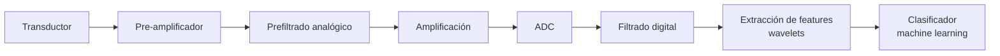
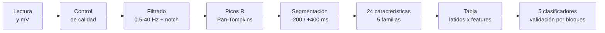

## Extracción de características para ECG
### 1.1 Cadena de procesamiento



| Bloque | Etapas |
|---|---|
| Acondicionamiento de la señal | Transductor, pre-amplificador |
| Filtrado analógico | Prefiltrado, amplificación |
| Adquisición de datos | ADC |
| Filtrado digital | Filtrado |
| Wavelets | Extracción de features |
| Machine learning | Clasificador |

La parte de extracción de features y clasificación:

1. Comprensión del negocio (*Business Understanding*)
2. Comprensión de los datos (*Data Understanding*)
3. Preparación de los datos (*Data Preparation*)
4. Modelado (*Modeling*)
5. Evaluación (*Evaluation*)
6. Despliegue (*Deployment*)

### 1.2 Fisiología del ECG

**Sistema de conducción del corazón**

`Nodo sinoauricular` → `Vías internodales` → `Nodo auriculoventricular` → `Haz de His` → `Ramas del haz de His` → `Sistema de Purkinje`

El ECG es la señal que registra la actividad eléctrica del corazón. Este se adquiere de forma digital o en papel milimetrado de 1 mm x 1 mm, con líneas gruesas de 5 mm. En el eje vertical, 10 mm = 1 mV.

| Elemento | Qué representa |
|---|---|
| **Onda P** | Despolarización auricular |
| **Complejo QRS** | Despolarización ventricular |
| **Onda T** | Repolarización ventricular |

**Derivaciones:** se organizan en el plano frontal (DI, DII, DIII, aVR, aVL, aVF) y en el plano horizontal (V1 a V6, entre otras).

### 1.3 Importancia de la extracción de features

- Es importante tener características robustas.
- Latidos con morfologías similares pueden pertenecer a clases distintas.
- El ruido y la variabilidad fisiológica exigen que las features capturen la información relevante.
- El objetivo es diseñar y combinar varios tipos de features para maximizar la discriminación entre latidos.

### 1.4 Familias de features

| Familia | Qué incluye | Idea clave |
|---|---|---|
| **Estadísticas básicas** | Media, mediana, desviación estándar, percentiles (IQR) | Caracterizan la distribución de amplitudes |
| **Orden superior (HOS)** | *Skewness* (3.er momento centrado) y *kurtosis* (4.º momento centrado) | Capturan información no lineal, como colas largas o picos puntiagudos. Ayudan a diferenciar latidos parecidos |
| **Espectrales** (dominio frecuencia) | FFT de cada latido, banda principal, potencia total en 0.5–40 Hz | La AHA recomienda llegar hasta 100 Hz |
| **Morfológicas** (dominio tiempo) | Picos R (`peakutils`), duración del QRS, amplitud de R y T, onda P, intervalo PR, duración de T | Ventana típica de 200 ms antes de R a 400 ms después |
| **Wavelet** | Filtrado (bior4.4 o db4, 9 niveles) para quitar ruido y *baseline wander* | Los coeficientes de detalle también son features |
| **Tiempo-frecuencia** | CWT y STFT (escalogramas y espectrogramas) | Convierten la señal en imágenes para CNN 2D (VGG, ResNet, Xception, DenseNet) |

- LSTM: trabaja sobre la señal cruda o sobre una señal codificada por un autoencoder (CAE-LSTM).
- Síntesis con VAE: encoder, espacio latente (distribución y muestreo) y decoder generan un ECG sintético.
- Aumentación de datos: transformaciones geométricas simples.

## 2. Laboratorio
### 2.1 Objetivo y datos

El objetivo es extraer características de la señal ECG para clasificar latidos según la condición fisiológica en que se registraron.

Se usan 12 archivos de BITalino (4 condiciones por 3 derivaciones).

| Condición | Qué hace el participante |
|---|---|
| Basal | Reposo con respiración normal |
| Hiperventilación | Ciclos repetidos de inhalar, mantener y exhalar |
| Hipoventilación | Retiene la respiración el mayor tiempo posible |
| Aeróbica | Registro justo después de unos 3 min de ejercicio |

| Derivación (triángulo de Einthoven) | Diferencia que mide |
|---|---|
| DI | LA − RA |
| DII | LL − RA |
| DIII | LL − LA |

### 2.2 Pipeline completo


### 2.3 Paso 1: lectura y conversión a mV

El archivo de OpenSignals trae una cabecera JSON (frecuencia de muestreo, resolución, canales) y columnas de datos (`nSeq`, entradas y salidas digitales, canal analógico del ECG).
Las cuentas del ADC se pasan a milivoltios con la fórmula del sensor ECG de BITalino:

$$
ECG_{mV} = \frac{\left(\dfrac{ADC}{2^{n}} - \dfrac{1}{2}\right) \cdot V_{CC}}{G_{ECG}} \times 1000
$$

con $V_{CC} = 3.3\ V$, $G_{ECG} = 1100$ y $n = 10$ bits.

Además se revisan dos aspectos de la adquisición:

- Paquetes perdidos: `nSeq` debe avanzar de 1 en 1 (módulo 16). Un salto indica pérdida de muestras por Bluetooth.
- Saturación: muestras pegadas al límite del ADC (0 o ≥ 1022). La señal real era mayor de lo que el equipo pudo medir.

### 2.4 Paso 2: control de calidad

1. Polaridad. Si el skewness es negativo, el QRS apunta hacia abajo y la señal se invierte. Un ECG con picos hacia arriba tiene asimetría positiva.
2. Detección de picos R con Pan-Tompkins (ver paso 4).
3. Control de intervalos RR. Un RR es anómalo si se aleja más de 35 % de la mediana local (ventana de 9 vecinos).
4. Latidos válidos. Tienen ventana completa (−200/+400 ms) y RR normales a ambos lados.

Frecuencia cardiaca: se calcula con los RR no anómalos.

$$
FC = \frac{60}{RR}\ \text{(lpm)}
$$

- Regla: se trabaja con una sola derivación a la vez. Si se mezclan, el clasificador aprendería la derivación y no la condición fisiológica.

Criterios para elegir la derivación: que estén las 4 condiciones, que tenga pocos archivos con problemas de calidad y que el QRS sea positivo (para que las medidas morfológicas conserven su nombre anatómico).

### 2.5 Paso 3: filtrado

| Problema | Origen | Frecuencia | Solución |
|---|---|---|---|
| Deriva de línea base | La respiración mueve el tórax y los electrodos | < 0.5 Hz | Pasa-altos 0.5 Hz |
| Interferencia de red | Instalación eléctrica (Perú: 60 Hz) | 60 Hz | Filtro *notch* 60 Hz |
| Ruido muscular y electrónico | Músculos cercanos y electrónica | > 40 Hz | Pasa-bajos 40 Hz |

- Se usa un pasa-banda Butterworth de 0.5 a 40 Hz (banda recomendada para la morfología del ECG) más un notch de 60 Hz.
- El filtrado se aplica "ida y vuelta" (`filtfilt`) para no desplazar las ondas en el tiempo. Si el pico R se moviera, las medidas de tiempo saldrían mal.

| Paso | Operación | Por qué |
|---|---|---|
| 1 | Pasa-banda 5–15 Hz | La energía del QRS está en esa banda. P y T son más lentas |
| 2 | Derivada | El QRS tiene las pendientes más empinadas del latido |
| 3 | Elevar al cuadrado | Todo queda positivo y las pendientes grandes se agrandan aún más |
| 4 | Integración en ventana móvil de 150 ms | Convierte cada QRS en una sola "joroba" suave |
| 5 | Umbral + periodo refractario de 250 ms | Una joroba sobre el umbral es un latido. No puede haber dos latidos en menos de 250 ms (máx. 240 lpm) |
| 6 | Ubicar el R | Se busca el máximo del ECG filtrado a ±100 ms de cada joroba |

El umbral usado es `0.3 × percentil 99` de la señal integrada.


### 2.7 Paso 5: segmentación en latidos

Se recorta una ventana de **200 ms antes y 400 ms después** de cada pico R. A 1000 Hz son 600 muestras por latido.

```text
          200 ms        400 ms
       |<------->R<------------------>|
          P   Q  R  S        T
```

- Se descartan el primer y el último latido, porque no tienen RR a ambos lados.
- Se descartan los latidos con RR anómalo.

### 2.8 Paso 6: extracción de 24 características

| Familia | Pregunta que responde | Características |
|---|---|---|
| **1. Ritmo** | ¿Cuándo llegó el latido? | RR previo, RR siguiente, FC instantánea |
| **2. Morfológicas** | ¿Qué forma tiene? | Amplitudes de P, Q, R, S y T, duración Q–S, tiempo R→T |
| **3. Estadísticas básicas** | ¿Cómo se reparten sus valores? | Media, mediana, desviación estándar, percentiles 25 y 75 |
| **4. Orden superior (HOS)** | ¿Es simétrico? ¿Es puntiagudo? | Asimetría y curtosis |
| **5. Frecuencia** | ¿De qué frecuencias está hecho? | FFT (frecuencia dominante, potencia 0.5–40 Hz, fracción 5–15 Hz) y wavelet (energía de 4 niveles) |

#### Estadísticas básicas y HOS

Los 600 valores del latido se tratan como datos de una distribución.

| Característica | Interpretación |
|---|---|
| Media y mediana | Valor típico del latido |
| Desviación estándar | Dispersión de los valores, relacionada con la energía del latido |
| Percentiles 25 y 75 | Valores bajo los cuales está el 25 % y el 75 % de las muestras |
| Asimetría (*skewness*, 3.er orden) | Un R alto y estrecho da asimetría positiva |
| Curtosis (4.º orden) | Un R muy agudo con el resto plano da curtosis alta |

### 2.9 Paso 7: tabla de características

Se juntan las cinco familias para todos los latidos.

| Elemento | Contenido |
|---|---|
| Fila | Un latido |
| Columna | Una característica |
| `clase` | La condición, es decir, la respuesta que el clasificador debe aprender |

Es exactamente el formato de datos tabulares que necesita un algoritmo de machine learning.

### 2.10 Paso 8: clasificación y validación

#### Los cinco clasificadores

| Algoritmo | Idea | Analogía |
|---|---|---|
| **Árbol de Decisión (DT)** | Hace preguntas de sí/no hasta decidir | Un diagrama de flujo |
| **Regresión Logística (LR)** | Suma las características con pesos y calcula la probabilidad de cada clase | Una balanza que suma evidencias |
| **Random Forest (RF)** | Entrena muchos árboles distintos y decide por votación | Un comité de expertos |
| **KNN** | Copia la clase de los *k* latidos conocidos más parecidos | "Dime con quién andas..." |
| **SVM** | Busca la frontera con el mayor margen entre clases | La "calle" más ancha entre grupos |

Antes de entrenar, las características se estandarizan con `StandardScaler`. En el artículo base, Random Forest obtuvo la mayor exactitud.

#### Métricas

| Métrica | Definición |
|---|---|
| Exactitud | Porcentaje de latidos bien clasificados |
| F1 macro | Promedio del F1 de cada clase. Es más justo cuando una clase tiene más latidos |

### 2.11 Limitaciones

- [ ] Un solo participante y unos 30 s por condición. El modelo aprende las condiciones de esta persona en esta sesión. Parte de lo que distingue dos archivos puede ser el propio registro (contacto de electrodos, minutos de diferencia) y no solo la fisiología.
- [ ] Medidas morfológicas aproximadas, porque usan ventanas fijas.
- [ ] Clases distintas a las del artículo. En el artículo las clases son tipos de latido (normales y patológicos) de muchos pacientes. Aquí son condiciones fisiológicas de un mismo sujeto. El procedimiento es el mismo, pero la pregunta es otra.


